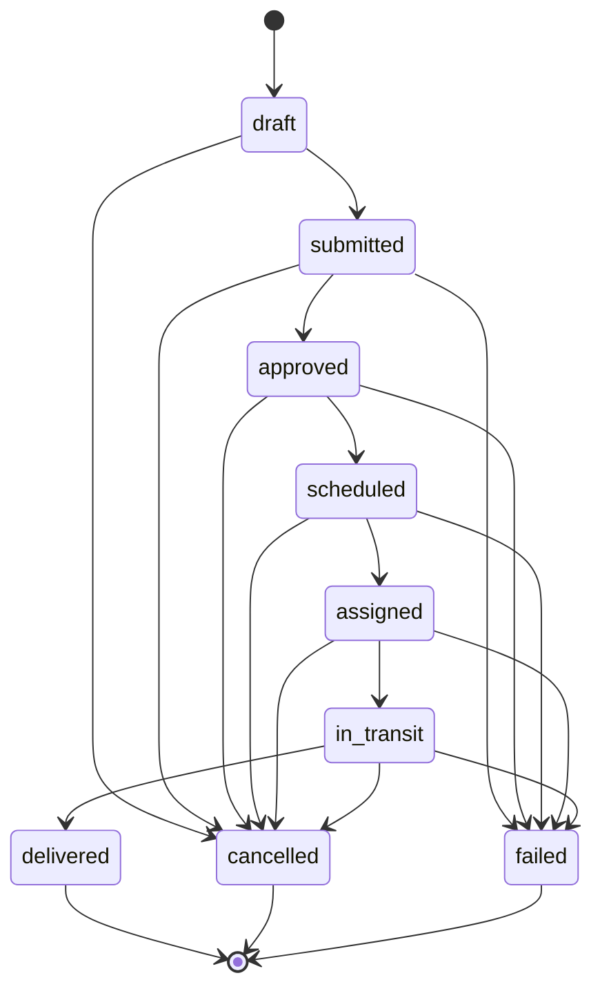
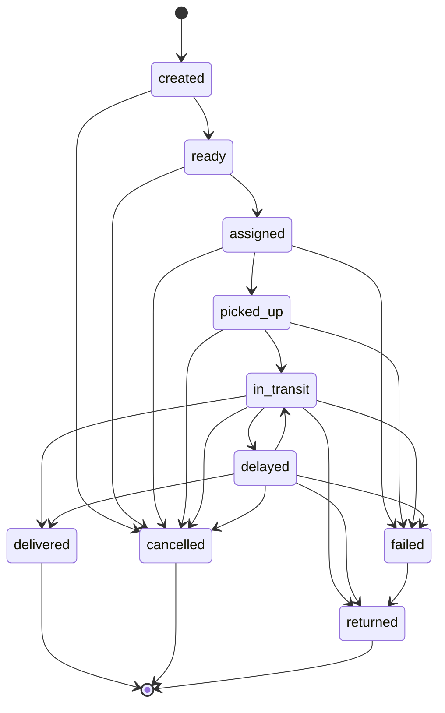
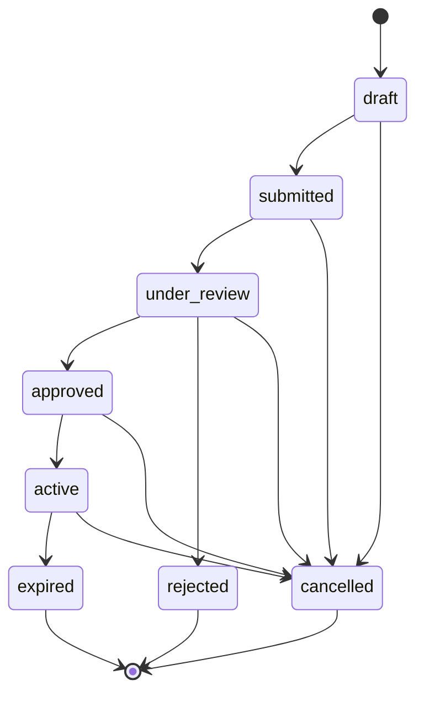

# المجالات (Domains)

يصف هذا المستند كل مجال (Bounded Context) منفَّذ في الواجهة الخلفية لمنصة «مسار» كما هو موجود فعلًا في `app/`. يتبع كل مجال البنية نفسها: النموذج `app/models/<x>.py` ← المستودع `app/repositories/<x>_repository.py` ← الخدمة `app/services/<x>_service.py` مع قواعد الحالة في `app/services/<x>_policies.py` ← المخططات `app/schemas/<x>.py` ← المسارات `app/api/routes/<x>.py` ← الأحداث `app/events/<x>_events.py`.
تُركَّب كل الموجِّهات تحت البادئة `/v1` في `app/api/v1/router.py` (موجِّه `driver_self` أولًا)، وتُفرض الصلاحيات عبر `require_roles(...)` من `app/core/security.py`، ويُحوَّل كل استثناء مجال إلى HTTP مركزيًا في `app/core/exceptions.py` (`_DOMAIN_ERROR_MAP`).

## المحتويات

1. [الهوية والصلاحيات والمستأجرون (Identity & Access, Tenancy)](#identity)
2. [إدارة العملاء (Customer Management)](#customers)
3. [الطلبات (Orders)](#orders)
4. [الشحنات والتتبع (Shipments & Tracking)](#shipments)
5. [الأسطول: السائقون والمركبات والمستودعات (Fleet)](#fleet)
6. [المعدات والأصول (Equipment & Assets)](#equipment)
7. [الامتثال والتصاريح (Compliance & Permits)](#compliance)
8. [التأمين والمطالبات (Insurance & Claims)](#insurance-claims)
9. [الفوترة والتسويات (Billing & Settlements)](#billing-settlements)
10. [الإشعارات (Notifications)](#notifications)
11. [التقارير والتحليلات (Reporting & Analytics)](#reporting-analytics)
12. [التكاملات و Webhooks (Integrations & Webhooks)](#integrations-webhooks)
13. [مجالات مخطط لها غير منفذة](#planned-domains)

### اصطلاحات مشتركة

| الموضوع | السلوك الفعلي في الكود |
|---|---|
| عزل المستأجر | كل جدول أعمال يحمل `tenant_id` (FK إلى `tenants`, `ondelete=RESTRICT`) ومحمي بسياسة RLS باسم `tenant_isolation` (الترحيلات 0003 ثم 0018 التي جعلتها fail-closed عبر `NULLIF`). المستودعات لا تضيف فلتر `tenant_id`؛ الخدمات تتحقق صراحةً من `obj.tenant_id` عند استقبال معرّف من العميل (`_require_tenant_owned`). |
| سياق الطلب | `get_current_user` (async) يربط `tid` و `sub` من الـ JWT بـ ContextVars؛ الخدمات تقرأ `get_current_tenant()` / `get_current_user_id()` وترفض العمل بـ `ValidationError` إن غاب المستأجر. الطلب غير المصادَق يعمل بنطاق المنصة `PLATFORM_TENANT_ID` (nil UUID) الذي يرى كل الصفوف (`app/db/session.py`). |
| القفل التفاؤلي (Optimistic Locking) | عمود `version` مع `__mapper_args__ = {"version_id_col": version}`؛ التعارض (`StaleDataError`) يُعاد كـ **409**. |
| الحذف الناعم (Soft Delete) | `SoftDeleteMixin` (`deleted_at`) + `deleted_by`. مُطبَّق فعلًا في Customers/Orders/Shipments/Equipment/Compliance فقط؛ مسارات users/drivers/vehicles/warehouses تحذف حذفًا فعليًا (انظر القسمين 1 و 5). |
| وحدة العمل والأحداث | الخدمة: `flush()` ← `EventEnvelope.create(...)` ← `EventStoreRepository.append()` ← `commit()` واحد، فيُكتب الصف والحدث في المعاملة نفسها (Transactional Outbox). |
| تخزين الـ Enum | أغلب المجالات تخزن **القيمة** بأحرف صغيرة (`values_callable=enum_values`). الاستثناءات التي تخزن **اسم العضو** بأحرف كبيرة: `shipments.status`، `shipment_tracking_events.event_type/status`، `users.role`، `vehicles.status`. |
| خريطة الأخطاء | `NotFoundError`→404، `ConflictError`/`CapacityError`/`AssignmentError`/`StatusTransitionError`→409، `TrackingEventError`/`ValidationError`→422. |

---

## 1. الهوية والصلاحيات والمستأجرون (Identity & Access, Tenancy)

**المسؤولية**: يملك المستأجرين (`tenants`) والمستخدمين (`users`) والأدوار، وإصدار رموز الوصول والتحديث وإبطالها، وربط هوية المستأجر بسياق الطلب. **لا يملك** الملف التشغيلي للسائق (ذلك في Fleet، القسم 5)، ولا بيانات العميل التجاري (Customers)، ولا مفاتيح API للشركاء (Integrations، القسم 12).

**الحالة**: Implemented + Tested — `tests/test_auth_routes.py`، `tests/test_auth_service.py`، `tests/test_token_service.py`، `tests/test_auth_context_propagation.py`، `tests/test_tenant_model.py`، `tests/test_tenant_isolation_pg.py` (PostgreSQL)، `tests/test_session_guc.py`، `tests/test_fleet_create_routes.py` (إنشاء مستخدم في مستأجر المدير)، `tests/test_driver_login_gate.py`.

**الملفات**:
- النماذج: `app/models/tenant.py`، `app/models/user.py`، `UserRole` في `app/models/enums.py`
- المستودعات: `app/repositories/tenant_repository.py`، `app/repositories/user_repository.py`
- الخدمات: `app/services/auth_service.py`، `app/core/security.py`، `app/core/token_service.py`، `app/db/tenant.py`، `app/db/session.py`
- المخططات: `app/schemas/auth.py`، `app/schemas/user.py`
- المسارات: `app/api/routes/auth.py`، `app/api/routes/users.py`، و `POST /auth/driver/login` في `app/api/routes/driver_self.py`
- الأحداث: لا توجد أحداث مجال للهوية.
- الترحيلات: `0001_baseline` (users)، `0003_multi_tenancy_rls` (tenants + مستأجر المنصة + RLS)، `0004_lifecycle_audit_columns`، `0018_rls_policy_nullif_fail_closed`

**الكيانات الرئيسية**:
- `Tenant` (`tenants`): `slug` فريد عالميًا (`uq_tenants_slug`)، `status ∈ {active, suspended}`، `isolation_mode ∈ {shared, dedicated}`، `region`، `settings` (JSONB)، `version`. لا يحمل `tenant_id` لأنه حدّ العزل نفسه. مستأجر المنصة هو nil UUID (`is_platform`) ومزروع بالترحيل 0003. معرّفه UUIDv4 لا UUIDv7.
- `User` (`users`): `email` فريد **لكل مستأجر** (`uq_users_tenant_id_email`) وليس عالميًا، `hashed_password` (bcrypt بعامل `bcrypt_work_factor`)، `role` (`UserRole`)، `is_active`، `version`، Soft Delete mixin. علاقة 1:1 اختيارية مع `Driver`.
- الأدوار (`UserRole`): `admin`، `manager`، `driver`، `client`. لكل مستخدم دور واحد.

**قواعد الأعمال المهمة**:
- **التسجيل الذاتي** (`AuthService.register`): يُطبَّع `tenant_slug` (trim + lower)، ويُرفض الفارغ أو اسم المنظمة الفارغ (422)، ويُرفض الـ slug المكرر (409). يُنشأ المستأجر والمستخدم `ADMIN` في معاملة واحدة ويُعاد زوج رموز مباشرة.
- **تسجيل الدخول** (`POST /auth/login`): `tenant_slug` اختياري؛ إن وُجد يُقيَّد البحث بذلك المستأجر، وإلا فالبحث بالبريد يعيد أول تطابق تحت نطاق المنصة. المستخدم غير النشط أو كلمة المرور الخاطئة أو الـ slug المجهول ← 401 بالرسالة نفسها.
- **رمز الوصول (JWT)**: يحمل `sub` (معرّف المستخدم)، `role`، `tid` (المستأجر)، `iat`، `exp`، و `jti` عند الإصدار عبر `issue_token_pair`.
- **رمز التحديث**: سلسلة UUID معتمة مخزنة في Redis بالمفتاح `refresh:{token}` ومدة `refresh_token_expire_minutes`. التدوير أحادي الاستخدام عبر `GETDEL` الذري (`TokenService.consume_refresh_token`)، فإعادة استخدام الرمز ← 401.
- **تسجيل الخروج**: يضيف `jti` إلى `denylist:{jti}` بمدة تساوي ما تبقى من عمر الرمز، ويحذف رمز التحديث إن أُرسل. فحص الـ denylist في `_authenticate` دفاعي: انقطاع Redis يُسجَّل ولا يمنع المصادقة.
- **ربط المستأجر** (`get_current_user`, async): يُعاد ربط `tid` و `sub` في سياق الطلب نفسه، فيصلان إلى الخدمات وإلى GUC الخاص بـ RLS في كل معاملة لاحقة. ترويسة `X-Tenant-ID` من العميل لا تتغلب أبدًا على مستأجر الرمز (كان هذا خللًا أُصلح في إعادة الهيكلة؛ يغطيه `test_tenant_header_cannot_override_token_tenant`).
- **الإنشاء الإداري للمستخدم** (`POST /users`): `tenant_id` يؤخذ من المدير المستدعي ولا يُقبل من الجسم.
- المستخدم غير الموجود أو `is_active=False` ← 401 حتى مع رمز صالح.

**تسجيل دخول السائق بالهاتف** (`POST /auth/driver/login`) — **قيد معروف**: التحقق من OTP ما يزال stub يقبل أي رمز (`DriverService.login_by_phone`)، لذلك يعيد المسار **501** عندما `ENVIRONMENT=production` (`settings.is_production`). خارج الإنتاج يبحث عن السائق بـ `phone_number` ويشترط مستخدمًا نشطًا بدور `DRIVER`، ثم يصدر رمز وصول عبر `create_access_token` **بلا `jti` وبلا رمز تحديث**، فلا يمكن إبطاله بـ `/auth/logout`.

**واجهات API**:

| Method | Path | الأدوار |
|---|---|---|
| POST | `/v1/auth/register` | عام |
| POST | `/v1/auth/login` | عام |
| POST | `/v1/auth/refresh` | عام (يتطلب refresh token) |
| POST | `/v1/auth/logout` | أي مستخدم مصادَق |
| GET | `/v1/auth/me` | أي مستخدم مصادَق |
| POST | `/v1/auth/driver/login` | عام (501 في الإنتاج) |
| POST | `/v1/users` | `admin` |
| GET | `/v1/users/{user_id}` | `admin`, `manager` |
| PATCH | `/v1/users/{user_id}` | `admin` (يعيد تجزئة كلمة المرور إن أُرسلت) |
| DELETE | `/v1/users/{user_id}` | `admin` |

لا يوجد `GET /users` للقائمة، ولا أي مسار لإدارة المستأجرين بعد التسجيل.

**قيود معروفة**: `UserRepository.delete` حذف فعلي (`session.delete`) رغم وجود `SoftDeleteMixin`، ومستودع المستخدمين يستدعي `commit()` بنفسه خلافًا لعقد `BaseRepository`.

**العلاقات مع المجالات الأخرى**: كل المجالات تعتمد على `require_roles` وعلى سياق المستأجر/المستخدم لملء `tenant_id` و `created_by`/`updated_by` و `user_id` في غلاف الحدث. `Shipment.client_id` و `Order.assigned_dispatcher_id` و `OperatorCertification.user_id` تشير إلى `users`.

---

## 2. إدارة العملاء (Customer Management)

**المسؤولية**: يملك هوية العميل التجاري (منظمة أو فرد): الرمز، الأسماء، السجل التجاري، الرقم الضريبي، بيانات التواصل والعنوان، والمؤشرات `risk_level` و `credit_status`، ودورة حالته. **لا يملك** الطلبات ولا الفواتير ولا قرارات الائتمان (لا توجد خدمة تقرأ `credit_status` لمنع أي عملية؛ هو حقل وصفي وفلتر بحث فقط).

**الحالة**: Implemented + Tested — `tests/test_customer_model.py`، `tests/test_customer_service.py`، `tests/test_customer_routes.py`، `tests/test_customer_events.py`.

**الملفات**:
- النموذج: `app/models/customer.py`
- المستودع: `app/repositories/customer_repository.py`
- الخدمة: `app/services/customer_service.py` (آلة الحالة مضمّنة في الخدمة كـ `_ALLOWED_TRANSITIONS`، لا يوجد `customer_policies.py`)
- المخططات: `app/schemas/customer.py`
- المسارات: `app/api/routes/customers.py`
- الأحداث: `app/events/customer_events.py`
- الترحيل: `0006_customer_domain`

**الكيانات الرئيسية** — `Customer` (`customers`):
- فريد لكل مستأجر: `code` (`uq_customers_tenant_id_code`)، `commercial_registration`، `vat_number`.
- `code` يُحوَّل إلى أحرف كبيرة عند الإنشاء.
- `customer_type ∈ {individual, corporate, government, sme}` (افتراضي `corporate`).
- `status ∈ {active, suspended, inactive}`، `risk_level ∈ {low, medium, high}`، `credit_status ∈ {good, watch, blocked}` — كلها مفروضة بـ CheckConstraint.
- حقول تواصل (`contact_person`, `primary_phone`, `primary_email`, ...)، عنوان (`country`, `city`, `district`, `address`, `latitude`, `longitude`)، `preferred_language`، `tags` (JSONB)، `notes`.
- Soft Delete + `deleted_by` + `version`.

**آلة الحالات** (`_ALLOWED_TRANSITIONS` في `customer_service.py`):

| من | إلى |
|---|---|
| `active` | `suspended`, `inactive` |
| `suspended` | `active`, `inactive` |
| `inactive` | `active` |

لا توجد حالة نهائية. الانتقال إلى الحالة نفسها no-op idempotent.

**قواعد الأعمال المهمة** (`customer_service.py`):
- فحص التفرد قبل الإنشاء والتعديل لـ `code` و `commercial_registration` و `vat_number` ← 409.
- العميل المحذوف ناعمًا يُعامل كغير موجود (404) في القراءة والتعديل وتغيير الحالة؛ `include_deleted` متاح في القائمة والبحث.
- الاستعادة (`restore_customer`) ترفض عميلًا غير محذوف (422).
- التعديل يصنّف الحقول المتغيرة: حقول التواصل ← `CustomerContactUpdated`، حقول العنوان ← `CustomerAddressUpdated`، والباقي ← `CustomerUpdated`.
- تغيير الحالة يطلق دائمًا `CustomerStatusChanged`، مع `CustomerActivated` أو `CustomerSuspended` حسب الهدف.

**الأحداث**: `CustomerCreated`، `CustomerUpdated`، `CustomerActivated`، `CustomerSuspended`، `CustomerDeleted`، `CustomerRestored`، `CustomerContactUpdated`، `CustomerAddressUpdated`، `CustomerStatusChanged`.

**واجهات API** (`/v1/customers`):

| Method | Path | الأدوار |
|---|---|---|
| POST | `/customers` | `admin`, `manager` |
| GET | `/customers/search` | `admin`, `manager`, `client` |
| GET | `/customers` | `admin`, `manager`, `client` |
| GET | `/customers/{customer_id}` | `admin`, `manager`, `client` |
| PATCH | `/customers/{customer_id}` | `admin`, `manager` |
| DELETE | `/customers/{customer_id}` | `admin` (soft delete) |
| POST | `/customers/{customer_id}/restore` | `admin` |
| POST | `/customers/{customer_id}/activate` | `admin`, `manager` |
| POST | `/customers/{customer_id}/suspend` | `admin`, `manager` |

`deactivate_customer` (→ `inactive`) موجود في الخدمة **بلا مسار API**. القائمة/البحث تدعم الفلاتر `q`, `status`, `customer_type`, `risk_level`, `credit_status`, `country`, `city` مع الترقيم والفرز.

**قيود معروفة**: دور `client` يقرأ كل عملاء المستأجر (لا فلتر ملكية).

**العلاقات مع المجالات الأخرى**: `orders.customer_id` يشير إلى `customers` (`ondelete=RESTRICT`) ويتحقق `OrderService` من وجوده. الفوترة والتحليلات تستهلك معرّف العميل (القسمان 9 و 11). الشحنات **لا** تشير إلى `customers` (انظر القسم 4).

---

## 3. الطلبات (Orders)

**المسؤولية**: يملك دورة الحياة **التجارية** لطلب النقل: الإنشاء كمسودة، التقديم، الموافقة، الجدولة، الإسناد إلى مُرسِل (dispatcher)، ثم الإغلاق. **لا يملك** التنفيذ الفعلي للنقل (السائق، المركبة، الالتقاط، التتبع)؛ ذلك في Shipment. لا يوجد ربط آلي بين حالة الطلب وحالة الشحنة: كل منهما يُنقل بمسارات منفصلة ولا يوجد معالج أحداث يزامنهما.

**الحالة**: Implemented + Tested — `tests/test_order_model.py`، `tests/test_order_service.py`، `tests/test_order_routes.py`، `tests/test_order_events.py`.

**الملفات**:
- النموذج: `app/models/order.py`
- المستودع: `app/repositories/order_repository.py`
- الخدمة: `app/services/order_service.py`
- السياسات: `app/services/order_policies.py` (`OrderStateMachine`)
- المخططات: `app/schemas/order.py`
- المسارات: `app/api/routes/orders.py`
- الأحداث: `app/events/order_events.py`
- الترحيل: `0007_order_domain`

**الكيانات الرئيسية** — `Order` (`orders`):
- `order_number` فريد لكل مستأجر (`uq_orders_tenant_id_order_number`)؛ يُولَّد `ORD-<12 hex>` إن لم يُرسل ويُحوَّل إلى أحرف كبيرة.
- `customer_id` (FK إلى `customers`, RESTRICT)، `assigned_dispatcher_id` (FK إلى `users`, SET NULL).
- `order_type ∈ {standard, express, same_day, economy, return}`، `order_source ∈ {web, mobile, api, phone, email, walk_in}`، `priority ∈ {low, normal, high, urgent}`.
- المواقع والإحداثيات، `distance_km ≥ 0`، `estimated_duration_minutes`، بيانات الحمولة (`cargo_weight_kg ≥ 0`, `cargo_volume_m3`, `dangerous_goods`, `is_fragile`, `temperature_requirements`, `insurance_required`).
- طوابع زمنية لكل مرحلة: `submitted_at`, `approved_at`, `scheduled_at`, `assigned_at`, `picked_up_at`, `delivered_at`, `cancelled_at`, `failed_at` + `cancellation_reason`, `failure_reason`.
- Soft Delete + `deleted_by` + `version`.

**آلة الحالات** (`OrderStateMachine.ALLOWED_TRANSITIONS`):

- الحالات النهائية (`TERMINAL_STATES`): `delivered`، `cancelled`، `failed`.
- التعويض (`COMPENSATION_STATES`): الإلغاء من `assigned` أو `in_transit` يضع `compensation_required=True` في حدث `OrderCancelled`. هذا علم في الحدث فقط؛ لا يوجد مستهلك ينفّذ التعويض آليًا.

**قواعد الأعمال المهمة** (`order_service.py`):
- الإنشاء يشترط عميلًا موجودًا وغير محذوف ضمن المستأجر (وإلا 422)، ويرفض `order_number` المكرر (409)، ويفرض `status=draft` متجاهلًا أي قيمة مُرسلة.
- التعديل (PATCH) ممنوع على الطلب المحذوف (404) أو في حالة نهائية (422). تغيير `priority` ← `OrderPriorityChanged`؛ حقول العنوان ← `OrderAddressChanged`؛ الباقي ← `OrderUpdated`.
- كل انتقال يمر عبر `OrderStateMachine.validate_transition` (المخالف ← 409)؛ الانتقال إلى الحالة نفسها no-op.
- `assign_order` يشترط أن يكون `assigned_dispatcher_id` مستخدمًا موجودًا وغير محذوف ومن المستأجر نفسه (422). لا يُفحص دور المستخدم.
- `start-transit` يضبط `picked_up_at` ويطلق `OrderPickedUp` ثم `OrderInTransit`.
- كل انتقال يطلق `OrderStatusChanged` إضافةً إلى الحدث الخاص.
- لا يوجد فحص لـ `credit_status` أو حالة العميل (`suspended`/`inactive`) عند إنشاء الطلب أو الموافقة عليه.

**الأحداث**: `OrderCreated`، `OrderSubmitted`، `OrderApproved`، `OrderScheduled`، `OrderAssigned`، `OrderPickedUp`، `OrderInTransit`، `OrderDelivered`، `OrderCancelled`، `OrderFailed`، `OrderRestored`، `OrderUpdated`، `OrderPriorityChanged`، `OrderAddressChanged`، `OrderStatusChanged`، `OrderDeleted`.

**واجهات API** (`/v1/orders`). مجموعات الأدوار في رأس `orders.py`: `_WRITE_ROLES=(admin, manager)`، `_FIELD_ROLES=(admin, manager, driver)`، `_READ_ROLES=(admin, manager, client, driver)`.

| Method | Path | الأدوار |
|---|---|---|
| POST | `/orders` | WRITE |
| GET | `/orders/search`, `/orders`, `/orders/{order_id}` | READ |
| PATCH | `/orders/{order_id}` | WRITE |
| DELETE | `/orders/{order_id}` | `admin` (soft delete) |
| POST | `/orders/{order_id}/restore` | `admin` |
| POST | `/orders/{order_id}/submit` · `/approve` · `/schedule` · `/assign` · `/cancel` | WRITE |
| POST | `/orders/{order_id}/start-transit` · `/deliver` · `/fail` | FIELD |

**قيود معروفة**: `client` و `driver` يقرآن كل طلبات المستأجر، و `driver` يستطيع تنفيذ `start-transit`/`deliver`/`fail` على أي طلب في المستأجر.

**العلاقات مع المجالات الأخرى**: يستهلك Customers (تحقق الوجود) و Identity (المُرسِل). `shipments.order_id` اختياري (SET NULL) ويُتحقق من ملكيته عند إنشاء الشحنة أو تعديلها. الفوترة (عروض الأسعار والفواتير) والتحليلات تشير إلى الطلب.

---

## 4. الشحنات والتتبع (Shipments & Tracking)

**المسؤولية**: يملك **تنفيذ** النقل: ربط مستودعي المنشأ والوجهة، إسناد السائق والمركبة، الالتقاط، العبور، التأخير، التسليم، الفشل، الإرجاع، الإلغاء، وسجل التتبع الإلحاقي (`shipment_tracking_events`). **لا يملك** القرار التجاري (Order)، ولا حالة المعدة (Equipment)، ولا منطق التصاريح (Compliance)؛ يستدعي بوابة الإرسال من Compliance فقط.

**الحالة**: Implemented + Tested — `tests/test_shipment_model.py`، `tests/test_shipment_repository.py`، `tests/test_shipment_service.py` (يشمل `assign_driver_only` و `create_tracking_event`)، `tests/test_shipment_routes.py`، `tests/test_shipment_state_machine.py`، `tests/test_shipment_events.py`، `tests/test_shipment_equipment_integration.py`، `tests/test_shipment_compliance_integration.py`، `tests/test_dispatch_gate.py`.

**الملفات**:
- النماذج: `app/models/shipment.py`، `app/models/shipment_tracking_event.py`
- المستودعات: `app/repositories/shipment_repository.py`، `app/repositories/tracking_event_repository.py`
- الخدمة: `app/services/shipment_service.py`
- السياسات: `app/services/shipment_policies.py` (`ShipmentStateMachine`)
- المخططات: `app/schemas/shipment.py`، `app/schemas/tracking_event.py`
- المسارات: `app/api/routes/shipments.py` (+ مسارات السائق في `driver_self.py`، القسم 5)
- الأحداث: `app/events/shipment_events.py` (+ `DispatchBlockedByCompliance`/`DispatchClearedByCompliance` من `compliance_events.py`)
- الترحيلات: `0001_baseline`، `0002_shipment_offer_fields`، `0004_lifecycle_audit_columns`، `0008_shipment_domain`، `0019_shipments_equipment_id_index`

**الكيانات الرئيسية**:
- `Shipment` (`shipments`):
  - `reference_code` فريد لكل مستأجر (`uq_shipments_tenant_id_reference_code`)، يُولَّد إن لم يُرسل.
  - `client_id` → `users.id` (RESTRICT) — **مستخدم** وليس صفًا في `customers`.
  - `order_id` → `orders` (SET NULL)، `origin_warehouse_id` و `destination_warehouse_id` → `warehouses` (RESTRICT)، `driver_id` → `drivers`، `vehicle_id` → `vehicles`، `equipment_id` → `equipment` (كلها SET NULL).
  - `weight_kg > 0`، `volume_m3 > 0`، `priority ∈ {low, normal, high, urgent}` (قيمة صغيرة)، `currency_code` بنمط `^[A-Z]{3}$` (افتراضي `SAR`).
  - حقول عرض السائق (0002): `cargo_type`، `price_sar`، `required_vehicle_type`.
  - طوابع زمنية: `pickup_at`, `delivery_due_at`, `assigned_at`, `picked_up_at`, `delivered_at`, `cancelled_at`, `failed_at` + `failure_reason`, `return_reason`.
  - **`status` يخزن اسم العضو بأحرف كبيرة** (`READY`, `IN_TRANSIT`...) لأن العمود بلا `values_callable`؛ لذلك الفهارس الجزئية مكتوبة بأحرف كبيرة.
  - فهارس جزئية: `ix_shipments_ready_unassigned` (`status='READY' AND driver_id IS NULL`) لتغذية عروض السائقين، و `ix_shipments_active_driver` / `ix_shipments_active_vehicle` على الحالات `ASSIGNED, PICKED_UP, IN_TRANSIT, DELAYED` غير المحذوفة لدعم فحص حصرية الإسناد.
  - Soft Delete + `deleted_by` + `version`.
- `ShipmentTrackingEvent` (`shipment_tracking_events`): سجل إلحاقي فقط بلا Soft Delete ولا `version`. `event_type ∈ {status_update, location_update, proof_of_delivery, exception}`، `status` اختياري، `event_time` (يجب أن يحمل منطقة زمنية)، `latitude`/`longitude`، `notes`، `recorded_by_user_id`، `evidence_url`. فهرس `(shipment_id, event_time)`.

**آلة الحالات** (`ShipmentStateMachine.ALLOWED_TRANSITIONS`):

- `TERMINAL_STATES` (ممنوع التعديل): `delivered`، `cancelled`، `returned`، `failed`. الحالة `failed` تسمح مع ذلك بانتقال لاحق واحد إلى `returned`.
- `delayed` طبقة فوق العبور: يُستأنف إلى `in_transit` عبر مسار `/transit` نفسه.
- `COMPENSATION_STATES`: الإلغاء من `assigned`/`picked_up`/`in_transit`/`delayed` يضع `compensation_required=True` في `ShipmentCancelled`.

**قواعد الأعمال المهمة** (`shipment_service.py`):
- **الإنشاء**: يُفرض `status=created`. يجب أن يكون `client_id` والمستودعان و `order_id` (إن وُجد) موجودين وغير محذوفين ومن المستأجر نفسه (422). المرجع المكرر ← 409.
- **سعة المستودع** (`_assert_capacity`): عند الإنشاء يُجمع وزن وحجم الشحنات النشطة (`created`…`delayed`، غير المحذوفة) لكل من مستودعي المنشأ والوجهة، ويُرفض تجاوز `capacity_weight_kg`/`capacity_volume_m3` (`CapacityError` ← 409). الحساب لحظي بلا سجل حجوزات.
- **التحقق من المعدة** (`_validate_equipment`، عند الإنشاء والتعديل): المعدة من المستأجر، غير `decommissioned` (422)، في حالة قابلة للإسناد (`EquipmentStateMachine.is_assignable`، وإلا 409)، وغير مرتبطة بشحنة نشطة أخرى (409)، ووزن/حجم الشحنة لا يقل عن وزن/حجم المعدة (422).
- **التعديل**: ممنوع في الحالات النهائية (422)؛ يعيد التحقق من المستودعات والطلب والمعدة وتفرد المرجع. حقول المستودعات ← `ShipmentAddressChanged`، حقول الحمولة ← `ShipmentCargoChanged`، والباقي ← `ShipmentUpdated`.
- **الإسناد** (`assign_shipment`، `ready → assigned`) يشترط **سائقًا ومركبة معًا** من المستأجر:
  - السائق غير محذوف، مرتبط بمستخدم نشط غير محذوف بدور `DRIVER` و`is_available=True`.
  - المركبة `status == ACTIVE`.
  - **حصرية الإسناد**: السائق والمركبة غير مسندين إلى شحنة نشطة أخرى (`has_active_driver_assignment`/`has_active_vehicle_assignment`).
  - وزن/حجم الشحنة ≤ سعة المركبة.
  - كل مخالفة ← `AssignmentError` (409).
- **بوابة الإرسال** (`_enforce_dispatch_gate`): تُستدعى قبل `assign` و `pickup` و `transit`، وتنطبق فقط على الشحنات التي تحمل `equipment_id`. عند المنع يُحفظ `DispatchBlockedByCompliance` ويُنفَّذ commit ثم يُرفع `ConflictError` (409). عند السماح يُحفظ `DispatchClearedByCompliance` ويُنفَّذ commit **قبل** التحقق من الانتقال نفسه. التفاصيل في القسم 7.
- **التسليم** يطلق `ShipmentDelivered` مُثرى بـ `planned_delivery_at`، `picked_up_at`، `delay_minutes`، `order_id`، `customer_id` (يأخذ قيمة `client_id`، أي معرّف مستخدم).
- **حدث التتبع** (`POST /shipments/{id}/events`): `event_time` يجب ألا يسبق آخر حدث مسجل (`TrackingEventError` ← 422). إن حمل `status` مختلفة يُتحقق من الانتقال بالآلة، وتُحدَّث الشحنة (`delivered_at`/`cancelled_at`/`picked_up_at` = `event_time`)، ويُطلق `ShipmentStatusChanged` بسبب `"tracking event"`. لا يُطلق حدث مجال لحدث التتبع نفسه، ولا يمر هذا المسار ببوابة الإرسال.
- **قبول السائق الذاتي** (`assign_driver_only`، القسم 5): يسند السائق فقط (`vehicle_id` يبقى فارغًا) من `created` أو `ready` مباشرة إلى `assigned`.
- الحذف ناعم (`ShipmentDeleted`) والاستعادة ترفض شحنة غير محذوفة.

**الأحداث**: `ShipmentCreated`، `ShipmentMarkedReady`، `ShipmentAssigned`، `ShipmentPickedUp`، `ShipmentInTransit`، `ShipmentDelayed`، `ShipmentDelivered`، `ShipmentFailed`، `ShipmentReturned`، `ShipmentCancelled`، `ShipmentUpdated`، `ShipmentDeleted`، `ShipmentRestored`، `ShipmentAddressChanged`، `ShipmentCargoChanged`، `ShipmentDriverChanged`، `ShipmentVehicleChanged`، `ShipmentStatusChanged`. الحدثان `ShipmentDriverChanged` و `ShipmentVehicleChanged` مسجلان لكن لا تطلقهما الخدمة حاليًا.

**واجهات API** (`/v1/shipments`). مجموعات الأدوار في رأس `shipments.py`: `_WRITE_ROLES=(admin, manager)`، `_FIELD_ROLES=(admin, manager, driver)`، `_READ_ROLES=(admin, manager, client, driver)`.

| Method | Path | الأدوار |
|---|---|---|
| POST | `/shipments` | WRITE |
| GET | `/shipments/search`, `/shipments`, `/shipments/{shipment_id}` | READ |
| PATCH | `/shipments/{shipment_id}` | WRITE |
| DELETE | `/shipments/{shipment_id}` | `admin` |
| POST | `/shipments/{shipment_id}/restore` | `admin` |
| POST | `/shipments/{shipment_id}/ready` · `/assign` (body: `driver_id`, `vehicle_id`) | WRITE |
| POST | `/shipments/{shipment_id}/pickup` · `/transit` · `/delay` · `/deliver` · `/fail` | FIELD |
| POST | `/shipments/{shipment_id}/return` · `/cancel` | WRITE |
| POST | `/shipments/{shipment_id}/events` | FIELD (إلحاق حدث تتبع) |

لا يوجد مسار `GET` لقراءة سجل التتبع؛ `TrackingEventRepository.list_for_shipment` موجود دون مسار.

**قيود معروفة**: `client` و `driver` يقرآن كل شحنات المستأجر؛ `driver` ينفّذ الانتقالات الميدانية وحدث التتبع على **أي** شحنة في المستأجر وليس على شحناته فقط. `recorded_by_user_id` في حدث التتبع يُقبل من جسم الطلب ولا يُستمد من المستخدم المصادَق.

**العلاقات مع المجالات الأخرى**: يقرأ Identity (`client_id`)، Orders (`order_id`)، Fleet (المستودعات، السائق، المركبة)، Equipment (`EquipmentRepository` و `EquipmentStateMachine`)، Compliance (`ComplianceValidationService`). أحداثه تستهلكها التحليلات والإشعارات و Webhooks والمطالبات (الأقسام 8–12). لا يغيّر حالة المعدة ولا حالة الطلب.

---

## 5. الأسطول: السائقون والمركبات والمستودعات (Fleet)

**المسؤولية**: يملك بيانات الأسطول المرجعية: الملف التشغيلي للسائق (رخصة، هاتف، توفر)، المركبات (لوحة، VIN، سعة، حالة)، والمستودعات (موقع، سعة). ويملك واجهة الخدمة الذاتية للسائق في تطبيق الجوال. **لا يملك** منطق الإسناد ولا حصريته؛ هذه قواعد في `ShipmentService` يعيد `DriverService` استخدامها. هو مجال CRUD بسيط: بلا طبقة خدمة للـ CRUD (المسارات تستدعي المستودعات مباشرة)، وبلا أحداث مجال.

**الحالة**: Implemented، والاختبارات جزئية — `tests/test_fleet_create_routes.py` (ربط `tenant_id` بالمستدعي عند إنشاء warehouse/vehicle/driver)، `tests/test_driver_login_gate.py` (501 في الإنتاج، 401 لرقم غير معروف). `assign_driver_only` مغطى في `tests/test_shipment_service.py`. لا توجد اختبارات مخصصة لـ `/drivers/me` و `/shipments/nearby` و `accept`/`decline` و `daily_stats`.

**الملفات**:
- النماذج: `app/models/driver.py`، `app/models/vehicle.py`، `app/models/warehouse.py`، `VehicleStatus` في `app/models/enums.py`
- المستودعات: `app/repositories/driver_repository.py`، `app/repositories/vehicle_repository.py`، `app/repositories/warehouse_repository.py`
- الخدمة: `app/services/driver_service.py` (الخدمة الذاتية فقط)، `app/api/deps.py` (`get_current_driver`)
- المخططات: `app/schemas/driver.py`، `app/schemas/driver_self.py`، `app/schemas/vehicle.py`، `app/schemas/warehouse.py`
- المسارات: `app/api/routes/drivers.py`، `app/api/routes/vehicles.py`، `app/api/routes/warehouses.py`، `app/api/routes/driver_self.py`
- الأحداث: لا توجد.
- الترحيلات: `0001_baseline`، `0003_multi_tenancy_rls`، `0004_lifecycle_audit_columns`

**الكيانات الرئيسية**:
- `Driver` (`drivers`): `user_id` → `users` (CASCADE)، فريد لكل مستأجر مع `tenant_id` (`uq_drivers_tenant_id_user_id`)؛ `license_number` فريد لكل مستأجر؛ `license_class`؛ `phone_number` (غير فريد)؛ `is_available` (افتراضي true)؛ `home_warehouse_id` (SET NULL)؛ `version`. **لا توجد آلة حالات للسائق**؛ `is_available` هو المؤشر الوحيد.
- `Vehicle` (`vehicles`): `plate_number` و `vin` فريدان لكل مستأجر؛ `status ∈ {ACTIVE, MAINTENANCE, DECOMMISSIONED}` (يُخزَّن الاسم بأحرف كبيرة)؛ `capacity_weight_kg`، `capacity_volume_m3`؛ `home_warehouse_id`؛ `version`. **لا يوجد حارس انتقال** على `status`؛ يمكن تغييره بـ PATCH إلى أي قيمة.
- `Warehouse` (`warehouses`): `code` فريد لكل مستأجر؛ عنوان كامل (`address_line1`, `city`, `country`, ...)؛ `latitude`/`longitude`؛ `capacity_weight_kg`، `capacity_volume_m3` (تستخدمهما سعة الشحنات)؛ `max_daily_shipments` (غير مستخدم في أي فحص)؛ `version`.

**قواعد الأعمال المهمة**:
- الإنشاء في المسارات الثلاثة يأخذ `tenant_id` من المستخدم المستدعي (`current_user.tenant_id`) ولا يقبله من العميل (أُصلح في إعادة الهيكلة).
- أهلية الإسناد تُقيَّم في `ShipmentService`: السائق `is_available` ومرتبط بمستخدم `DRIVER`، المركبة `ACTIVE`، سعة المركبة كافية، ولا إسناد نشط آخر (القسم 4).
- **الخدمة الذاتية للسائق** (`driver_service.py`، و `get_current_driver` يشترط دور `DRIVER` وملف سائق مرتبطًا، وإلا 403/404):
  - `PATCH /drivers/me` يبدّل `is_available` فقط.
  - `GET /shipments/nearby`: أول 20 شحنة بحالة `READY` وبلا سائق في المستأجر. **لا يوجد فلتر جغرافي** رغم الاسم؛ `distance_km` هو مسافة Haversine بين مستودعي المنشأ والوجهة، لا بين السائق والشحنة.
  - `POST /shipments/{id}/accept` ← `ShipmentService.assign_driver_only`: يتحقق من أهلية السائق وحصريته وأن الشحنة `created` أو `ready`، ثم يضبط `status=ASSIGNED` بلا مركبة ويطلق `ShipmentAssigned` (`vehicle_id=None`) و `ShipmentStatusChanged`. هذا المسار **لا يمر** بـ `ShipmentStateMachine` (يسمح بـ `created → assigned` المرفوض في الآلة) ولا ببوابة الامتثال. المسار يحوّل `AssignmentError`/`StatusTransitionError` إلى **400** محليًا، لا إلى 409 كما في الخريطة العامة.
  - `POST /shipments/{id}/decline`: يتحقق من وجود الشحنة فقط، بلا أي تغيير في الحالة؛ يبقى العرض `READY` ظاهرًا لغيره.
  - `GET /drivers/me/stats`: الأرباح وعدد الرحلات من شحنات اليوم المسلَّمة (UTC)؛ `online_hours` و `distance_km` تعاد صفرًا (بانتظار Projections).

**واجهات API**:

| Method | Path | الأدوار |
|---|---|---|
| POST / GET / PATCH / DELETE | `/v1/drivers`, `/v1/drivers/{driver_id}` | `admin`, `manager` |
| POST / GET / PATCH / DELETE | `/v1/vehicles`, `/v1/vehicles/{vehicle_id}` | `admin`, `manager` |
| POST / GET / PATCH / DELETE | `/v1/warehouses`, `/v1/warehouses/{warehouse_id}` | `admin`, `manager` |
| GET / PATCH | `/v1/drivers/me` | سائق مصادَق (`get_current_driver`) |
| GET | `/v1/drivers/me/stats` | سائق |
| GET | `/v1/shipments/nearby` | سائق |
| POST | `/v1/shipments/{shipment_id}/accept` · `/decline` | سائق |

مسارات `driver_self` مكتوبة بمسارات كاملة بلا بادئة، ومُضمَّنة أولًا في `build_v1_router` حتى تسبق `/drivers/{id}` و `/shipments/{id}`.

**قيود معروفة**:
- `DELETE` في المجالات الثلاثة حذف فعلي (`session.delete` في `*_repository.py`) رغم `SoftDeleteMixin`، ويفشل على مستوى قاعدة البيانات إن وُجدت شحنات تشير إلى المستودع (RESTRICT).
- مستودعات Fleet تنفّذ `commit()` بنفسها خلافًا لعقد `BaseRepository`.
- `DriverRepository.get_by_phone` يعيد أول تطابق، و `phone_number` غير فريد، والبحث عند تسجيل الدخول يجري بنطاق المنصة، أي عبر كل المستأجرين.

**العلاقات مع المجالات الأخرى**: Shipments يستهلك السائق والمركبة والمستودعات؛ Equipment (`current_warehouse_id`) و Compliance (`vehicle_id` في التصاريح وملفات الأحمال المحورية) يشيران إلى المستودعات والمركبات؛ Identity يوفر المستخدم المرتبط بالسائق.

---

## 6. المعدات والأصول (Equipment & Assets)

**المسؤولية**: يملك وحدات المعدات الثقيلة التي تُنقل (موضوع الحركة)، وتصنيفاتها (`equipment_categories`) وموديلاتها (`equipment_models`)، وحالتها الدورية وتوفرها التشغيلي، ومتطلبات نقلها (`requires_permit`, `requires_escort`, `hazardous`, `insurance_required`, ...) وأبعادها. **لا يملك** قرار السماح بالإرسال (Compliance يقرأ هذه المتطلبات ويقرر)، ولا تنفيذ النقل (Shipment)، ولا التأمين.

**الحالة**: Implemented + Tested — `tests/test_equipment_model.py`، `tests/test_equipment_repository.py`، `tests/test_equipment_service.py`، `tests/test_equipment_routes.py`، `tests/test_equipment_state_machine.py`، `tests/test_equipment_events.py`، `tests/test_shipment_equipment_integration.py`، `tests/test_claims_equipment_integration.py`.

**الملفات**:
- النموذج: `app/models/equipment.py` (`EquipmentCategory`, `EquipmentModel`, `Equipment`)
- المستودع: `app/repositories/equipment_repository.py`
- الخدمة: `app/services/equipment_service.py`
- السياسات: `app/services/equipment_policies.py` (`EquipmentStateMachine`)
- المخططات: `app/schemas/equipment.py`
- المسارات: `app/api/routes/equipment.py`
- الأحداث: `app/events/equipment_events.py`
- الترحيلات: `0009_equipment_domain`، `0019_shipments_equipment_id_index`

**الكيانات الرئيسية**:
- `EquipmentCategory`: `code` فريد لكل مستأجر، `name`، `is_active`، `parent_id` (تسلسل هرمي)، Soft Delete، `version`.
- `EquipmentModel`: `code` فريد لكل مستأجر، `category_id`، `manufacturer`، `model_name`، `model_year`، Soft Delete، `version`.
- `Equipment` (`equipment`):
  - `equipment_code` و `asset_tag` فريدان لكل مستأجر؛ `serial_number` فريد لكل مستأجر عبر فهرس جزئي فريد (`serial_number IS NOT NULL AND deleted_at IS NULL`).
  - `category_id` (إلزامي)، `model_id`، `current_warehouse_id`، `current_location`.
  - `ownership_type ∈ {owned, leased, customer_owned, third_party}`.
  - `status ∈ {active, inactive, under_maintenance, reserved, in_transit, decommissioned}`.
  - `availability_status ∈ {available, reserved, unavailable, assigned, maintenance}`.
  - أبعاد غير سالبة: `weight_kg`, `length_m`, `width_m`, `height_m`, `volume_m3`.
  - أعلام متطلبات النقل: `requires_permit`, `requires_escort`, `requires_special_handling`, `hazardous`, `temperature_sensitive`, `insurance_required`.
  - Soft Delete + `deleted_by` + `version`.

**آلة الحالات** (`EquipmentStateMachine.ALLOWED_TRANSITIONS`):

| من | إلى |
|---|---|
| `active` | `under_maintenance`, `reserved`, `in_transit`, `inactive`, `decommissioned` |
| `under_maintenance` | `active` |
| `reserved` | `active`, `in_transit` |
| `in_transit` | `active` |
| `inactive` | `active`, `decommissioned` |
| `decommissioned` | — (نهائية) |

- `TERMINAL_STATES = {decommissioned}`.
- `NON_ASSIGNABLE_STATES = {inactive, under_maintenance, decommissioned}`، و `is_assignable()` تعيد False لها.
- كل عملية تضبط `availability_status` مع الحالة: `activate`/`release`/`complete_maintenance`/`mark_delivered` ← `available`؛ `deactivate`/`decommission` ← `unavailable`؛ `reserve` ← `reserved`؛ `start_maintenance` ← `maintenance`؛ `mark_in_transit` ← `assigned`.

**قواعد الأعمال المهمة** (`equipment_service.py`):
- الإنشاء: التصنيف (إلزامي) والموديل والمستودع يجب أن تكون من المستأجر (422)؛ تفرد `equipment_code` و `asset_tag` و `serial_number` (409)؛ تبدأ الوحدة دائمًا `active` و `available` بغض النظر عن المدخلات. الرمز يُولَّد إن لم يُرسل.
- التعديل ممنوع على المحذوفة (404) أو `decommissioned` (422). حقول الموقع ← `EquipmentLocationChanged`، حقول المواصفات ← `EquipmentSpecificationChanged`، والباقي ← `EquipmentUpdated`.
- `reserve_equipment` يشترط `availability_status == available`، وإلا 409.
- **لا يمكن إسناد معدة إلى شحنة وهي `inactive` أو `under_maintenance` أو `decommissioned`**؛ يُفرض في `assign_to_shipment` وفي `ShipmentService._validate_equipment` الذي يمنع أيضًا ربط المعدة بأكثر من شحنة نشطة.
- كل انتقال يطلق `EquipmentStatusChanged`، ومعه `EquipmentAvailabilityChanged` عند تغير التوفر.
- عمليات موجودة في الخدمة **بلا مسار API**: `assign_to_shipment`، `mark_in_transit`، `mark_delivered`، `update_category`، `update_model`. لا شيء يستدعيها آليًا: ربط معدة بشحنة عبر `equipment_id` لا يغيّر حالتها ولا توفرها، وتسليم الشحنة لا يعيدها `available`.

**الأحداث**: `EquipmentCreated`، `EquipmentUpdated`، `EquipmentActivated`، `EquipmentDeactivated`، `EquipmentReserved`، `EquipmentReleased`، `EquipmentAssignedToShipment`، `EquipmentInTransit`، `EquipmentDelivered`، `EquipmentMaintenanceStarted`، `EquipmentMaintenanceCompleted`، `EquipmentDecommissioned`، `EquipmentDeleted`، `EquipmentRestored`، `EquipmentStatusChanged`، `EquipmentAvailabilityChanged`، `EquipmentCategoryCreated`، `EquipmentModelCreated`، `EquipmentLocationChanged`، `EquipmentSpecificationChanged`.

**واجهات API** (`/v1/equipment`). مجموعات الأدوار: `_WRITE_ROLES=(admin, manager)`، `_FIELD_ROLES=(admin, manager, driver)`، `_READ_ROLES=(admin, manager, client, driver)`.

| Method | Path | الأدوار |
|---|---|---|
| POST | `/equipment` | WRITE |
| POST / GET | `/equipment/categories` | WRITE / READ |
| POST / GET | `/equipment/models` | WRITE / READ |
| GET | `/equipment/search`, `/equipment`, `/equipment/{equipment_id}` | READ |
| PATCH | `/equipment/{equipment_id}` | WRITE |
| DELETE | `/equipment/{equipment_id}` | `admin` |
| POST | `/equipment/{equipment_id}/restore` | `admin` |
| POST | `/equipment/{equipment_id}/activate` · `/deactivate` · `/reserve` · `/release` · `/decommission` | WRITE |
| POST | `/equipment/{equipment_id}/maintenance/start` · `/maintenance/complete` | FIELD |

**قيود معروفة**: `client` و `driver` يقرآن كل معدات المستأجر، و `driver` يستطيع بدء الصيانة وإنهاءها لأي وحدة.

**العلاقات مع المجالات الأخرى**: Shipments يشير إليها (`equipment_id`) ويتحقق من قابليتها للإسناد؛ Compliance يقرأ أعلامها وأبعادها لبوابة الإرسال، ويربط بها التصاريح وملفات الأحمال المحورية، وتربط بها شهادات المشغلين عبر `equipment_category_id`؛ Insurance/Claims يشير إليها (القسم 8)؛ Fleet يوفر `current_warehouse_id`.

---

## 7. الامتثال والتصاريح (Compliance & Permits)

**المسؤولية**: يملك القيود التنظيمية للنقل الثقيل وتحويلها إلى قرار إرسال قابل للتنفيذ: التصاريح ودورة حياتها، خطط المرافقة (escorts)، قيود الطرق، ملفات الأحمال المحورية، فحوص الامتثال المحفوظة، شهادات المشغلين، و**بوابة الإرسال** (Dispatch Gate). **لا يملك** حالة المعدة ولا حالة الشحنة؛ لا يغيّر أيًا منهما، بل يجيب Shipment بـ "مسموح / ممنوع مع الأسباب".

**الحالة**: Implemented + Tested — `tests/test_compliance_model.py`، `tests/test_compliance_repository.py`، `tests/test_compliance_service.py`، `tests/test_compliance_routes.py`، `tests/test_compliance_events.py`، `tests/test_permit_state_machine.py`، `tests/test_dispatch_gate.py`، `tests/test_shipment_compliance_integration.py`، `tests/test_claims_compliance_integration.py`.

**الملفات**:
- النموذج: `app/models/compliance.py`
- المستودع: `app/repositories/compliance_repository.py`
- الخدمة: `app/services/compliance_service.py` (`ComplianceService` للكتابة، و `ComplianceValidationService` لبوابة الإرسال للقراءة فقط)
- السياسات: `app/services/compliance_policies.py` (`PermitStateMachine`)
- المخططات: `app/schemas/compliance.py`
- المسارات: `app/api/routes/compliance.py`
- الأحداث: `app/events/compliance_events.py`
- الترحيل: `0010_compliance_permits_domain`

**الكيانات الرئيسية** (كلها tenant-scoped، Soft Delete، `deleted_by`، `version`):
- `Permit` (`permits`): `permit_number` فريد لكل مستأجر (يُولَّد إن لم يُرسل)؛ `shipment_id`، `equipment_id`، `vehicle_id`، `route_id` (UUID حر بلا FK)؛ `permit_type ∈ {oversize, overweight, government, municipal, special_movement, site_entry}`؛ `status`؛ `issuing_authority`، `region`؛ `valid_from`/`valid_until`؛ `requires_escort`، `requires_police_escort`؛ حدود `max_allowed_weight/height/width/length`؛ `conditions` (JSONB)؛ `rejection_reason` وطوابع المراحل.
- `Escort` (`escorts`): `shipment_id`، `permit_id`، `escort_type ∈ {private_escort, police_escort, pilot_vehicle, technical_support}`، `status ∈ {planned, scheduled, cancelled, completed}`، بيانات المزود والتواصل، `scheduled_start`/`scheduled_end`.
- `RouteRestriction` (`route_restrictions`): `region`، `road_name`، `restriction_type ∈ {weight_limit, height_limit, width_limit, length_limit, time_window, hazardous_material, road_closure}`، حدود الأبعاد، `start_date`/`end_date`، `active`.
- `AxleWeightProfile` (`axle_weight_profiles`): `equipment_id`/`vehicle_id`، `axle_count ≥ 0`، `total_weight`، `axle_weights` (JSONB)، `max_axle_weight`، `is_compliant`.
- `ComplianceCheck` (`compliance_checks`): `shipment_id`، `equipment_id`، `vehicle_id`، `permit_id`، `check_type` (`permit_required, permit_validity, escort_required, axle_weight, oversize, route_restriction, operator_certification, insurance_required, hazardous_material`)، `status ∈ {pending, passed, failed, warning, overridden}`، `blocking`، `failure_reasons` (JSONB)، `evaluated_at`/`evaluated_by`.
- `OperatorCertification` (`operator_certifications`): `user_id`، `equipment_category_id`، `certification_type`، `certification_number`، `valid_from`/`valid_until`، `status ∈ {active, expired, suspended, revoked}`.

**آلة حالات التصريح** (`PermitStateMachine.ALLOWED_TRANSITIONS`):

- `TERMINAL_STATES`: `rejected`، `expired`، `cancelled`. التصريح النهائي لا يُعدَّل (422).
- `DISPATCHABLE_STATES = {active}`: وحده التصريح `active` يجيز الإرسال.
- `approve` يقبل `valid_from`/`valid_until` اختياريًا ويضبط `approved_at`؛ `reject` يحفظ `rejection_reason`.
- لا يوجد انتهاء صلاحية آلي: الانتقال إلى `expired` يدوي عبر `/expire`.
- المرافقة (Escort) بلا آلة حالات رسمية: تُنشأ `planned`؛ `schedule` يرفض المرافقة الملغاة (409)؛ `cancel` يضبط `cancelled` دون فحص الحالة السابقة؛ لا يوجد مسار إلى `completed`.

**بوابة الإرسال** (`ComplianceValidationService.validate_dispatch(shipment, stage)`): للقراءة فقط (بلا أحداث وبلا commit)، يستدعيها `ShipmentService._enforce_dispatch_gate` عند `assign` و `pickup` و `transit`، وتعيد `DispatchGateResult(allowed, blocking_reasons, warnings, required_permits, required_escorts, compliance_check_ids)`:
1. شحنة بلا `equipment_id` ← مسموح مباشرة.
2. معدة مشار إليها غير موجودة ← **ممنوع** (fail closed).
3. إن كانت المعدة `requires_permit` أو `hazardous` أو **ضخمة** (oversize: `width_m > 2.6` أو `height_m > 4.5` أو `length_m > 16.0` أو `weight_kg > 45000`، ثوابت في `compliance_service.py`): يجب وجود تصريح `active` غير محذوف مرتبط **بالشحنة** (`get_active_permit_for_shipment`)، ضمن نافذة `valid_from`…`valid_until`؛ وإلا يُمنع الإرسال مع السبب.
4. إن كانت `requires_escort`: يجب وجود مرافقة `planned` أو `scheduled` للشحنة.
5. `insurance_required` ← تحذير استشاري فقط (لا يمنع).
6. أي `ComplianceCheck` محفوظ للشحنة بحالة `failed` و `blocking=True` يمنع الإرسال.

**قواعد الأعمال المهمة** (`compliance_service.py`):
- إنشاء التصريح والمرافقة وملف الأحمال يتحقق من أن `shipment_id`/`equipment_id`/`vehicle_id` المشار إليها من المستأجر (`_validate_refs`، 422)؛ `permit_number` المكرر ← 409.
- `evaluate_compliance(shipment_id)` (`POST /compliance/checks/evaluate`) يحفظ فحوصًا من أعلام المعدة: `permit_required` (blocking، ناجح إن وُجد تصريح `active`)، `oversize` (blocking)، `escort_required` (blocking)، `hazardous_material` و `insurance_required` (warning، غير blocking). يكتفي هذا التقييم بوجود تصريح `active` ولا يفحص نافذة الصلاحية كما تفعل البوابة. شحنة بلا معدة ← قائمة فارغة.
- `apply_compliance_override` يضع الفحص `overridden` و `blocking=False` مع سبب، فيرفع المنع عن البوابة؛ مسموح لـ `admin`/`manager`.
- قيود الطرق وملفات الأحمال المحورية وشهادات المشغلين **تُخزَّن فقط**: لا تقيّمها البوابة ولا `evaluate_compliance`، ولا يُفحص أي `OperatorCertification` عند إسناد السائق. `get_valid_operator_certification` و `get_active_permits_for_equipment` في المستودع غير مستخدمتين.
- `validate_dispatch_clearance(shipment_id, stage)` موجودة في `ComplianceService` بلا مسار API.

**الأحداث**: `PermitCreated`، `PermitSubmitted`، `PermitUnderReview`، `PermitApproved`، `PermitRejected`، `PermitActivated`، `PermitExpired`، `PermitCancelled`، `PermitDeleted`، `PermitRestored`، `EscortCreated`، `EscortScheduled`، `EscortCancelled`، `RouteRestrictionCreated`، `RouteRestrictionUpdated`، `AxleWeightProfileCreated`، `ComplianceCheckCreated`، `ComplianceCheckPassed`، `ComplianceCheckFailed`، `ComplianceOverrideApplied`، `OperatorCertificationCreated`، `OperatorCertificationExpired`، `DispatchBlockedByCompliance`، `DispatchClearedByCompliance` (الأخيران تطلقهما `ShipmentService` على تجميعة Shipment).

**واجهات API** (`/v1/compliance`). مجموعات الأدوار: `_WRITE=(admin, manager)`، `_READ=(admin, manager, client, driver)`، `_OVERRIDE=(admin, manager)`.

| Method | Path | الأدوار |
|---|---|---|
| POST | `/compliance/permits` | WRITE |
| GET | `/compliance/permits/search`, `/compliance/permits`, `/compliance/permits/{permit_id}` | READ |
| PATCH | `/compliance/permits/{permit_id}` | WRITE |
| DELETE | `/compliance/permits/{permit_id}` | `admin` |
| POST | `/compliance/permits/{permit_id}/restore` | `admin` |
| POST | `/compliance/permits/{permit_id}/submit` · `/review` · `/approve` · `/reject` · `/activate` · `/expire` · `/cancel` | WRITE |
| POST | `/compliance/checks/evaluate` | WRITE |
| GET | `/compliance/checks`, `/compliance/checks/{check_id}` | READ |
| POST | `/compliance/checks/{check_id}/override` | OVERRIDE |
| POST / GET | `/compliance/escorts` | WRITE / READ |
| POST | `/compliance/escorts/{escort_id}/schedule` · `/cancel` | WRITE |
| POST / GET | `/compliance/route-restrictions` | WRITE / READ |
| PATCH | `/compliance/route-restrictions/{restriction_id}` | WRITE |
| POST | `/compliance/axle-weight-profiles` | WRITE |
| POST / GET | `/compliance/operator-certifications` | WRITE / READ |
| POST | `/compliance/operator-certifications/{certification_id}/expire` | WRITE |

**قيود معروفة**: `client` و `driver` يقرآن كل تصاريح المستأجر وفحوصه ومرافقاته وشهاداته. لا يوجد مسار قراءة لملفات الأحمال المحورية.

**العلاقات مع المجالات الأخرى**: يقرأ Equipment (أعلام وأبعاد) و Shipments (`shipment_id`) و Fleet (`vehicle_id`) و Identity (`user_id` للشهادات). يستهلكه Shipments (البوابة) و Insurance/Claims (القسم 8). لا يستهلك أحداثًا من مجالات أخرى.

---

## 8. التأمين والمطالبات (Insurance & Claims)

**المسؤولية:** الوثائق والتغطية ودورة المطالبة والأضرار والمسؤولية. تشير إلى Shipment و Order
و Customer و Equipment و Compliance دون تغيير دوراتها؛ Billing تملك التسوية المالية.
المجال منفذ ومختبر، لكنه لا يمثل تكاملًا مع شركة تأمين.

**المصادر:** models/insurance.py و repositories/insurance_repository.py و
services/insurance_service.py و claims_service.py و insurance_policies.py، و schemas/insurance.py،
و api/routes/insurance.py و claims.py، و events/insurance_events.py. الترحيل 0011 ينشئ
insurance_policies و coverage_rules و claims و damage_reports و liability_records تحت RLS.

| الكيان | الحالات والقواعد |
| --- | --- |
| الوثيقة | draft→active→suspended/expired/cancelled؛ المعلقة تعود active أوتنتهي؛ draft تسمح cancelled |
| المطالبة | created→under_review→approved/rejected؛ approved→settled→closed و rejected→closed؛ إعادة فتح صريحة إلى under_review |
| التغطية | أعلام الوثيقة مفروضة على نوع المطالبة؛ القواعد التفصيلية مخزنة ولا تشكل محرك مطابقة كاملًا |
| الضرر والمسؤولية | أبناء للمطالبة؛ النسبة 0–100 ومجموعها≤100 إلا بتجاوز مخول |

الاعتماد يحتاج وثيقة active تغطي النوع ومبلغًا معتمدًا. تجاوز المطالب به يحتاج allow_override
للمسؤول؛ الرفض يحتاج سببًا، والتسوية تحتاج ملاحظات ومبلغًا معتمدًا. equipment_damage يحتاج
equipment_id. تتحقق الخدمة من ملكية المراجع. لا إنشاء آلي للمطالبة عند فشل شحنة، ولا انتهاء
تلقائي للوثائق، ولا إثبات آلي لمطابقة كل شروط شركة التأمين.

**API:** /v1/insurance/policies للإنشاء والقوائم والبحث والقراءة والتعديل وأفعال
activate/suspend/expire/cancel؛ coverage-rules للإنشاء والقائمة والتعديل. /v1/claims للإنشاء
والقوائم والبحث والقراءة والتعديل والحذف الناعم والاستعادة و review/approve/reject/settle/close/reopen،
وإنشاء/قائمة damage-reports و liability-records. القراءة للأدوار الأربعة والكتابة admin/manager،
والتجاوزات والحذف والاستعادة admin. الأحداث الدقيقة في insurance_events.py؛ أهمها InsurancePolicy*
و Claim* و DamageReportCreated و LiabilityRecordCreated. الاختبارات test_insurance_* و
 test_claim_state_machine.py و test_claims_*_integration.py.

---

## 9. الفوترة والتسويات (Billing & Settlements)

**المسؤولية:** Quote و Invoice و InvoiceLine و Payment و Settlement و Payout و Penalty. لا تملك
حالة Claim أو Order/Shipment. هذا سجل مالي وسير موافقات، لا بوابة دفع أوتحويل بنكي أو ERP.
المصادر models/billing.py و repositories/billing_repository.py و services/billing_service.py
و settlement_service.py و billing_policies.py، و schemas/billing.py و api/routes/billing.py
و events/billing_events.py؛ الترحيل 0012. المجال منفذ ومختبر.

| الكيان | الانتقالات الرئيسية |
| --- | --- |
| Quote | draft→issued→approved/rejected/expired/cancelled؛ المعتمد يمكن إلغاؤه |
| Invoice | draft→issued/cancelled؛ الصادرة إلى partially_paid/paid/overdue/voided/cancelled؛ الجزئية إلى paid/overdue؛ المتأخرة إلى partially_paid/paid |
| Settlement | draft→pending_approval→approved→settled؛ الإلغاء ممكن قبل settled |
| Payment/Payout | الدفعة pending/confirmed/failed/reversed؛ الصرف يبدأ pending ولا نقطة عامة لتأكيده/فشله |

الحساب بـ Decimal وعملة صريحة. عرض السعر subtotal+tax−discount؛ لا يعتمد بعد valid_until
ولا تحول حالة expired إلى فاتورة. مجموع الفاتورة يحسب من صافي البنود بعد خصوماتها والضريبة
والغرامات وتعديل المطالبة، بحد أدنى صفر؛ الإصدار يحتاج إجماليًا موجبًا إلا للإشعار الدائن.
الرصيد=الإجمالي−الدفعات المؤكدة. يجب تطابق العملة؛ تجاوز الرصيد وإبطال فاتورة مدفوعة يحتاجان
تجاوز admin. الدفعة المعلقة لا تغير حالة الفاتورة.

التسوية المستندة لمطالبة تحتاج Claim approved/settled ومبلغًا≤المعتمد دون تجاوز. التحقق
لكل تسوية؛ لا تفترض وجود حساب تراكمي لاستهلاك المطالبة. يتحقق تعديل مبلغ التسوية أيضًا
من الحد المعتمد. consume_claim_settlement يضيف تعديل الفاتورة ويعيد حسابها ويكتب Outbox
في معاملة واحدة، ويرفض الفاتورة النهائية ولا يغير Claim. لا مستهلك آلي يحول ClaimSettled
إلى فاتورة. Payout يحتاج تسوية approved/settled ولا ينفذ صرفًا خارجيًا.

**API:** تحت /v1/billing تدعم quotes و invoices و settlements الإنشاء والقائمة والبحث والقراءة
والتعديل؛ أفعال العرض issue/approve/reject/expire/cancel، والفاتورة issue/void/cancel معقراءة
lines وإنشاء/قائمة payments، والتسوية submit/approve/settle/cancel وإنشاء/قائمة payouts،
و penalties إنشاء/قائمة. القراءة للأدوار الأربعة والكتابة admin/manager والتجاوزات admin.
mark_overdue و mark_payment_failed موجودتان بالخدمة دون جدولة/نقطة عامة مخصصة.
الأحداث Quote*/Invoice*/Settlement* و PaymentRecorded/Failed و PayoutCreated و PenaltyApplied
و CancellationFeeApplied و ClaimSettlementConsumed. الاختبارات test_billing_* وآلات Quote/Invoice/Settlement.

---

## 10. الإشعارات (Notifications)

**المسؤولية:** القوالب والرسائل والقراءة ومحاولات التسليم دون تغيير كيان المصدر.
**Partial ومختبر:** in_app تعمل؛ email/SMS/push/webhook هنا Null Providers تعيد
skipped/provider_not_configured ولا تدعي نجاح التسليم.
المصادر models/notification.py و services/notification_service.py و notification_policies.py،
و repositories/notification_repository.py و notifications/handlers.py و providers.py
و events/notification_events.py؛ الترحيل 0013.

المسار pending→queued→sent→read مع failed وإعادة إلى queued و cancelled؛ كل Attempt سجل مستقل.
إنشاء إشعار من الحدث يستخدم مفتاحًا من event_id والقناة والمستلم، ومعالجة Dispatcher تحت
نطاق المستأجر. لا تستدع المعالجة الحية متجاوزًا حد منع التكرار. استخراج المستلم يعتمد على
حمولة المصدر ولا يضمن أن كل حدث يحدد مستخدمًا فعليًا.

**API:** /v1/notifications/templates للإنشاء والقائمة والبحث والقراءة والتعديل والحذف/الاستعادة
و activate/deactivate؛ /notifications للإنشاء والقائمة والبحث و unread والقراءة و queue/send/retry/cancel/read
وقراءة محاولات التسليم. الكتابة admin/manager، وحذف القالب واستعادته admin؛ غير المديرين
محصورون بإشعاراتهم في نقاط العرض والقراءة. توصيل مزود قناة عبر ProviderRegistry.register
خطوة صريحة؛ Webhook الإشعار منفصل عن Partner Webhooks. أحداث Notification* تغذي التحليلات؛
اختبارات test_notification_* و test_notifications_* تغطي المجال.

---

## 11. التقارير والتحليلات (Reporting & Analytics)

**المسؤولية:** نماذج قراءة قابلة للإعادة من event_store دون تعديل مصادرها. المجال منفذ
ومختبر. المصادر models/projection.py و services/projection_service.py و repositories/projection_repository.py،
و analytics/handlers.py و health.py و projections/engine.py و api/routes/analytics.py؛ الترحيلان 0014/0015.

الأنواع السبعة shipment_performance و financial_summary و ar_aging و claims_metrics و
compliance_metrics و notification_deliverability و operations_dashboard، مع projection_health؛
كلها تحت RLS. Builder الحي لا يلتزم؛ Dispatcher يلتزم بالتحديث وسجل processed_events معًا.
Rebuild يحذف إسقاط المستأجر المحدد ثم يعيد Replay بترتيب occurred_at و aggregate_version و event_id.

net_receivable_change تغير فترة قد يكون سالبًا وليس الرصيد المستحق؛ استخدم ar_aging للرصيد
حسب العميل. cumulative_collected_revenue تراكمي طوال العمر، والإيراد الدوري في financial_summary.
الأموال مفصولة بالعملة، والأحداث القديمة بلا عملة تعود SAR. الذمم Read-through من Invoice
لغياب بعض بيانات الاستحقاق بالحدث. بعض عدادات لوحة العمليات تقديرية وقد تنحرف عن الحالة
المفتوحة. Rebuild يحمل كل أحداث المستأجر بالذاكرة؛ لا Streaming Replay أو ضمان أداء مقيس.

**API:** قراءة admin/manager تحت /v1/analytics: dashboard و shipments/performance و financial/summary
و financial/ar-aging و claims/metrics و compliance/metrics و notifications/deliverability و projections/health.
إعادة البناء admin فقط عبر POST /projections/rebuild أو/projections/rebuild/{projection_type}
مع dry_run. فحص الصحة يصنف Healthy/Stale/Error ولا يعيد البناء آليًا. الاختبارات test_reporting_*.

---

## 12. الشركاء والتكاملات (Integrations & Webhooks)

**المسؤولية:** الشريك ومفاتيحه واشتراكاته وتسليماته وأحداثه الواردة. لا يملك حالة Order/Shipment
ولا يحول كل حدث وارد تلقائيًا إلى أمر أعمال. **Partial ومختبر:** HTTP Provider و Redis Limiter
موجودان لكن يحتاجان تسجيلًا عند الإقلاع. المصادر models/integration.py و repositories/integration_repository.py
و services/integration_service.py و schemas/integration.py و api/routes/integrations.py، و integrations/
و events/integration_events.py؛ الترحيلان 0016/0017 والجداول الستة في [قاعدة البيانات](database.md).

- مفتاح API يعرض مرة ويخزن تجزيؤه bcrypt. يلزم شريك ومفتاح نشطان غير منتهيين، ونطاق
  integrations:inbound:write وقائمة IP مسموحة إن ضُبطت.
- سر Webhook مشفر؛ الافتراضي Fernet مشتق من SECRET_KEY، ومزود KMS يحتاج توصيلًا وخطة تدوير.
- الصادر يختار الأحداث المسموحة وينقح Payload؛ قيد subscription_id+source_event_id يمنع
  إنشاء التسليم مرتين. التوقيع HMAC-SHA256 للجسم ومحاولات التسليم مسجلة مع التراجع.
- HTTPS وفحص العنوان يخففان SSRF؛ DNS Rebinding يحتاج ضابط شبكة. لا قفل كامل ضد تداخل
  التسليم، فالمستلم يحتاج Idempotency. يبقى HTTP داخل المعاملة.
- الوارد يوقع timestamp.raw_body ويشترط نافذة±300 ثانية. التوقيع غير الصحيح يسجل rejected
  مع 201؛ ليس حدثًا مقبولًا. المفتاح tenant_id+api_key_id+idempotency_key يمنع التكرار.
- محدد المعدل الافتراضي محلي للعملية؛ Redis يحتاج التسجيل. الاستلام لا يغير كيان أعمال؛
  process_inbound_event موجودة بالخدمة دون عامل تحويل عام للطلبات/الشحنات.

**API:** تحت /v1/integrations إدارة partners ومفاتيح partners/{id}/api-keys وإبطالها/تدويرها،
و webhook-subscriptions وتفعيلها/تعطيلها وتدوير السر، و webhook-deliveries وقائمة المستحق
والمحاولات وإعادة/إلغاء التسليم. الإدارة JWT لـ admin/manager مع عمليات حساسة لـ admin؛
POST /inbound/events بمفتاح الشريك. العقود والترويسات في [API](api.md).
التوصيل عبر set_webhook_provider و set_inbound_rate_limiter و set_secret_provider،
و webhook_delivery_sweep كل 60 ثانية. الاختبارات test_integration* و test_webhook* و test_inbound*.
مرجع التشغيل [operations.md](operations.md)، والأصل التاريخي [تقرير 28](archive/28-integration-delivery-worker-hardening.md).

---

## 13. المجالات المخططة

Contracts و Rental Agreements والتسعير المتقدم و SLA التجاري وإدارة المسارات و AI Operations
و ETA التنبؤي ولوحات برج التحكم والويب **Planned**. وجود تصميم أو enum أوحقل مرجعي لا يعني
تنفيذ المجال. العقود تملك شروط التأجير، Equipment تملك الأصل، Shipment يملك التنفيذ،
Compliance يملك الترخيص، و Billing تملك المالية؛ لا تدمج هذه الحدود لتقليل عدد الملفات.
