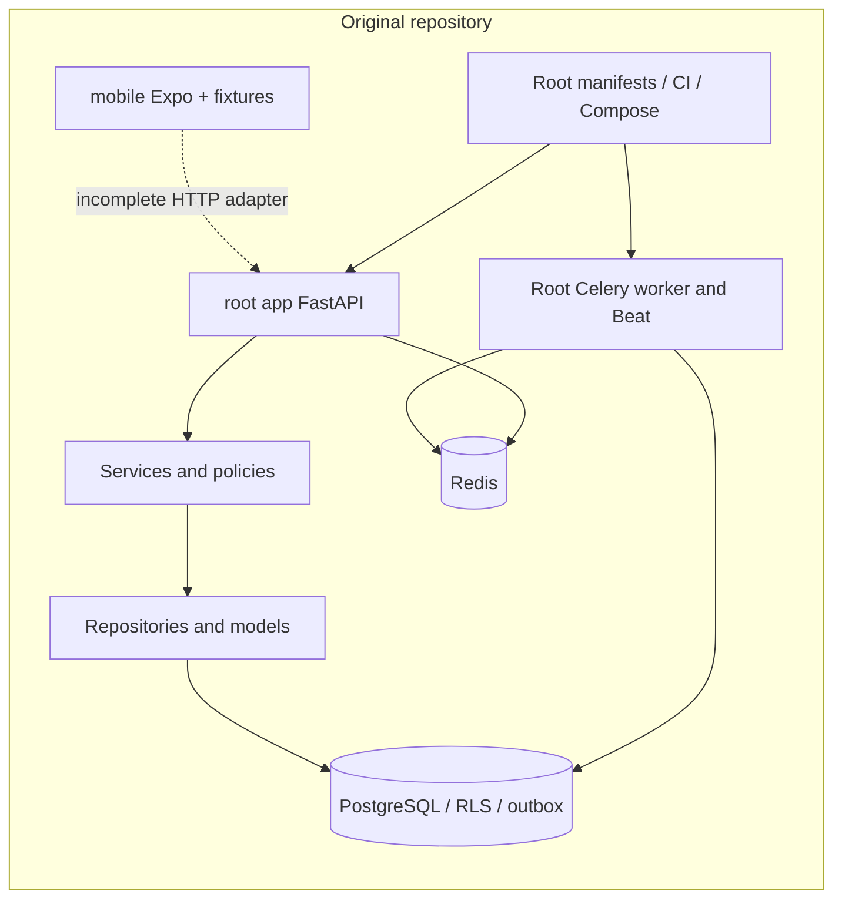
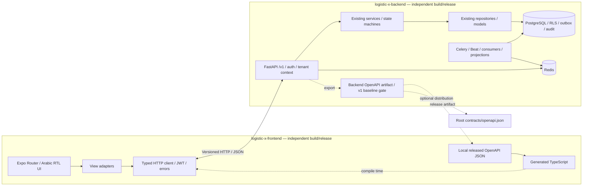

# Separation inventory and dependency map

Audit date: 2026-11-11. Code, manifests, tests, CI, and current documentation were
inspected before copying source. The numbered architecture/domain files requested
in the brief already live in `docs/archive/`; they describe several older milestones.
The current source and consolidated documents take precedence.

## Original architecture

| Area | Verified implementation |
| --- | --- |
| Backend | 168 Python modules under root `app/`; FastAPI, Pydantic 2, SQLAlchemy 2 |
| Layering | API → services/policies → repositories/models; `app` absolute imports |
| Data | PostgreSQL; 19 Alembic revisions; tenant GUCs/RLS; no schema move needed |
| Domains | Identity, users, fleet/drivers, warehouses, customers, orders, shipments/tracking, equipment, compliance, insurance/claims, billing/settlements, notifications, analytics, integrations |
| Events | Domain envelopes/registry, unified event_store/outbox, audit log, relay/dispatcher, idempotent consumers, projections |
| Workers | Celery API-independent worker/Beat; relay 30s, projection health 5min, webhook sweep 60s, diagnostic ping |
| Integrations | Redis tokens/cache/broker; HTTP webhooks/signing/encryption; notification providers |
| Frontend | `mobile/`: Expo SDK51, React18, React Native0.74, TypeScript5.3; Metro/Babel; Expo Router file routes |
| State/UI | React Context session + AsyncStorage; shared React Native components, Tajawal fonts, RTL, SVG maps; no Redux or Next.js implementation |
| Screens | Login, driver home, dynamic shipment offer detail |
| API mismatch | Default mock mode, unimplemented live login, camelCase expectations over snake_case responses, 204 parsed as JSON, mock deep-link fallback |
| Tooling | Root Python requirements/Makefile/Dockerfile/Compose/CI; mobile package/lock/typecheck; no web production build/tests before separation |
| Documents/design | Current docs plus archives, ADRs, Mermaid diagrams, design tokens and screen map; design assets were not imported by runtime code |

There was organizational/tooling coupling, not Python imports of TypeScript. No
server-rendered web dashboard or backend-owned frontend static assets were found.
Frontend source contained a hardcoded production-looking API fallback; backend
connection defaults and Compose credentials were local examples. The real root `.env`
was not printed, committed, or rewritten. Its configuration was copied privately to
the backend to preserve the working environment. No frontend receives those values.

## Final architecture

Each directory contains dependencies, environment example, Dockerfile, tests, build
commands and README. Backend also owns migrations, database bootstrap, worker commands
and a backend-only Compose file. Frontend contains its own schema/types and static web
server configuration. Root Compose/CI/docs are development/review tooling only.

## Boundaries preserved

- No Python import path changed: `app.main:app`, `app.workers.celery_app`, and all
  existing intra-backend imports still work from the backend directory.
- No migration, database table, event schema, service ownership, domain state machine,
  RBAC/JWT validation policy, or dispatch gate changed as part of separation.
- The exact pre-separation OpenAPI is checked against the application and exported
  snapshot. Root/frontend copies are checked in CI; frontend checks generated types.
- CORS uses environment-specific origins and exposes the existing request ID header.
- No runtime or build import crosses application directories. Contract distribution
  is an explicit release step and does not run during frontend install/build.

Historical design gaps remain historical product/security debt, not evidence that
planned dashboards, OTP, rental, or AI features were implemented by this migration.
See the final report for actual verification and remaining limitations.
